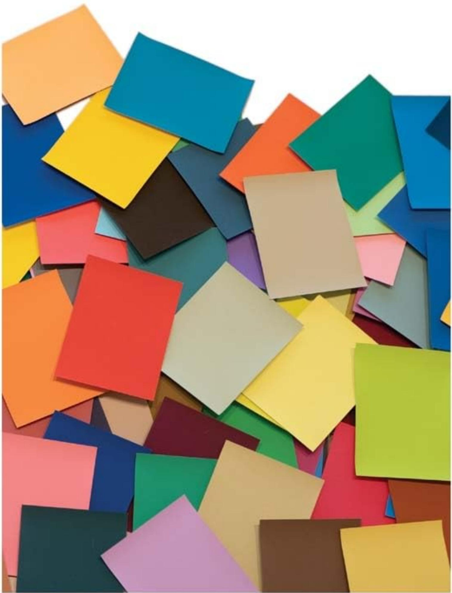
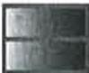
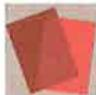
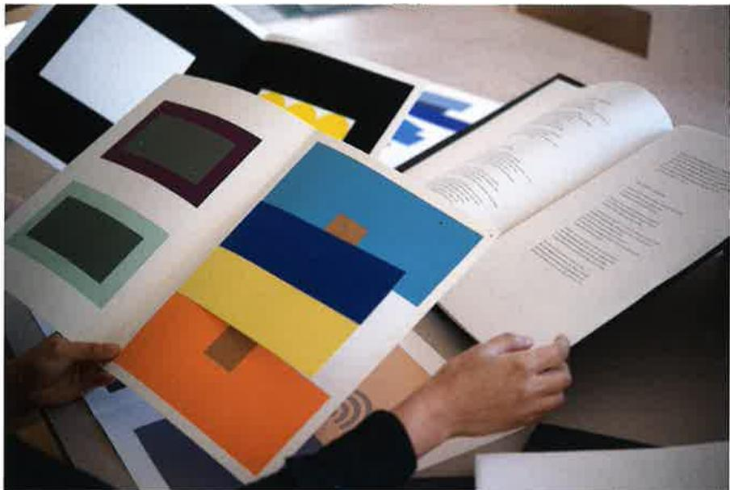
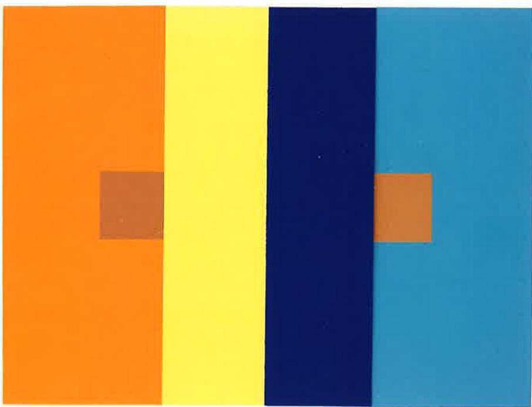
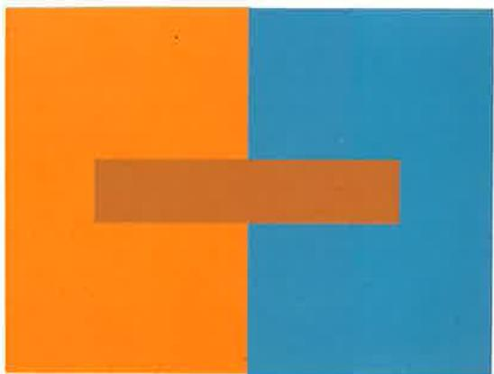
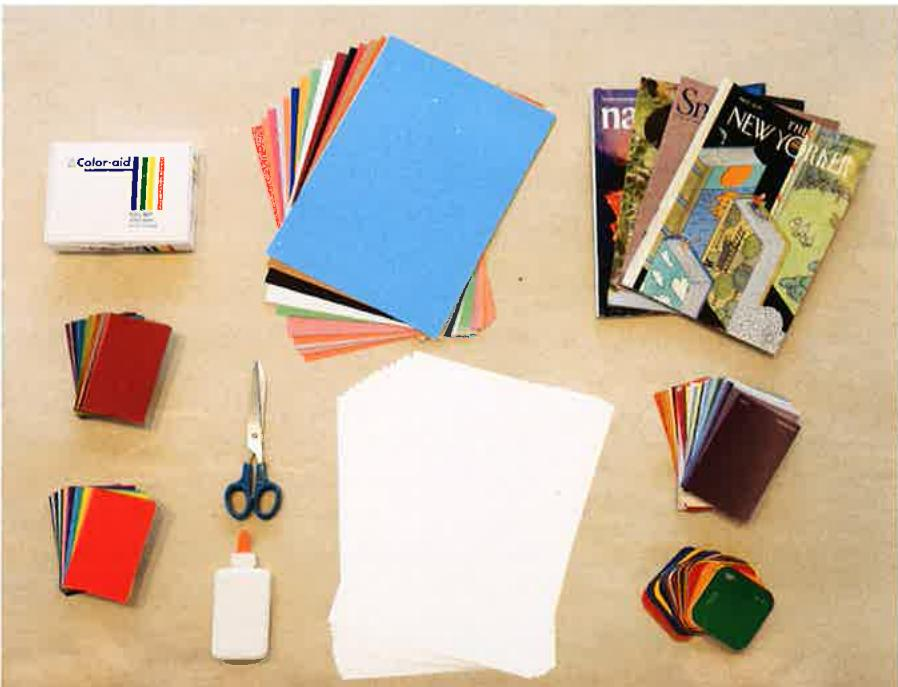
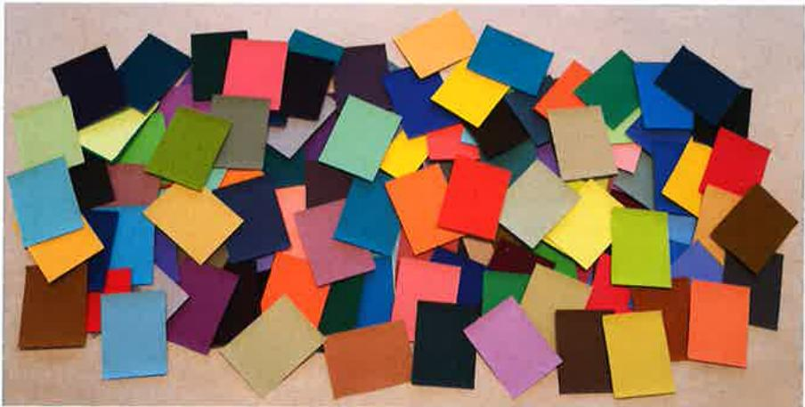
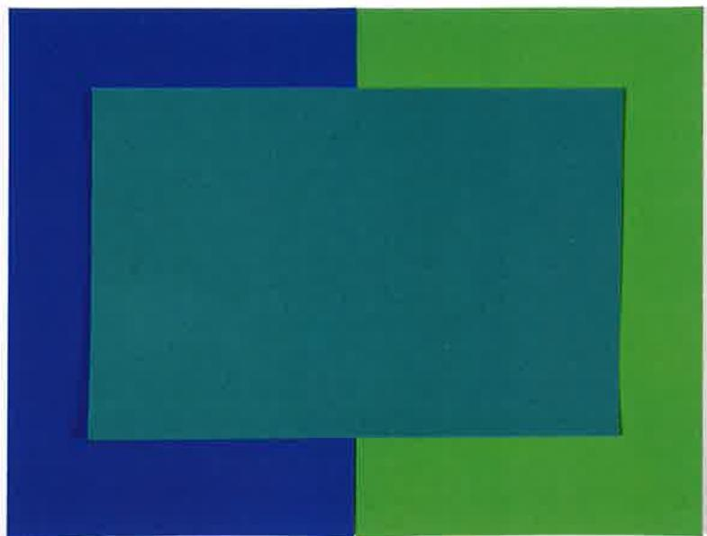

FRITZ HORSTMAN

## Interacting with Color

A Practical Guide to Josef Albers's Color Experiments

ALSO AVAILABLE

Interaction of Color: 5oth Anniversary Edition

Interaction of Color: New Complete Edition

Interaction of Color: Complete Digital Edition Available online: interactionofcolor.com

FRItz HorstmAN Interacting with Color

A Practical Guide to Josef Albers's Color Experiments

Copyright © 2024 by Fritz Horstman.   
All rights reserved.

This book may not be reproduced, in whole or in part, including illustrations, in any form (beyond that copying permitted by Sections 107 and 1o8 of the U.S. Copyright Law and except by reviewers for the public press), without written permission from the publishers.

yalebooks.com/art

Designed and set in New Baskerville type by BW&A Books, Inc. Printed in China by ioio Printing International Limited

Library of Congress Control Number: 2023946583   
ISBN 978-0-300-27243-7

A catalogue record for this book is available from the British Library.

This paper meets the requirements of ANSI/NISO Z39.48-1992 (Permanence of Paper).

10 9 8 76 5 4 3 21

CONTENTS

Foreword | Nicholas Fox Weber vii

Introduction 1

The exercises in this book are based on the following chapters or sections of chapters of Interaction of Color:

IV A color has many faces—the relativity of color 3

V Gradation studies—new presentations 25

VI1 color appears as 2—looking like the reversed grounds 39

VII Why color deception?—after-image 53

IX, XI Color mixture in paper— illusion of transparence, illusion of depth 67

XIV Color intervals and transformation 85

XVI Color juxtaposition—harmony—quantity 1o1

XVIII Fall leaf studies—an American discovery 111

Appendix 121

Acknowledgments 131

Image Credits 133

# FOREWORD

Interaction of Color is a masterpiece that fulfills the goal of Josef Albers's life: "to open eyes." His was a straightforward, heartfelt intention: Albers wanted people to further their appreciation of life itself through the joys of seeing. With messianic zeal, he longed for everyone—regardless of education or circumstances—to go with him to the enchanted territory of color performance and to savor the offerings of vision. Albers's revelations were accessible to one and all, for they are timeless and apprehensible universally.

The alchemy presented in Interaction is glorious in its simplicity, its dependability, and the sense of wonder it bestows on us. Colors are not merely what they first appear to be. They change—which is to say that our perception of them changes—according to their settings. A blue that is luminous and ethereal when surrounded by a dark red may seem solid, even brooding, when encased in a pale yellow. An X that looks gray on a yellow background appears to be yellow on a gray background, yet it is always the same exact hue. The miracles are endless.

Exult in the mysteries! Relish the way that there is no one truth. Celebrate the way that just about everything we see depends on context. Albers beckons you with his immense generosity of heart to enter his kingdom of delights.

The first Interaction of Color, published by Yale University Press in 1963, was a large, precious object: produced to be exquisite thanks to the quality of its design and printing and presentation. But its contents were meant to be distributed to the entire world. Soon enough, Interaction began to proliferate: in paperback editions, with its text translated into seventeen different languages, as well as in electronic form. Its theories became influential in the teaching of art. Albers's students became teachers of its ideas to their students, and the number of apostles multiplied. The mutability of hues and the means of demonstrating it became central to the teaching of art on every level.

Yet color transformation is not simply taught; it is experienced directly. Albers's goal was for us to engage in our own explorations. Interaction guides its readers to be activated. And in making that green look one way in one environment and different in another, the participants in this glorious search come to feel the extraordinary happenings acutely.

Interacting with Color: A Practical Guide to Josef Albers's Color Experiments is a fantastic step forward in the realization of Albers's dream. With its straightforward exercises, explained with eloquence and clarity, it expands the territory of perception. Its exercises are succinct and realizable for everyone, from small children to university professors; it fulfills a need that has existed ever since the original Interaction of Color was published. For the nearly twenty years to date that Fritz Horstman has been associated with the Josef and Anni Albers Foundation, he has been teaching this subject matter in museums, community centers, and educational institutions of every level. In so doing, he has developed the means to make the experimentation Albers encouraged more accessible than it has ever been before. Diligently, excitedly, Horstman has found the ways with which, with limited tools and materials, the larger audience can feel Albers's alchemy in full force. The exercises presented here succeed completely: this is a tremendous achievement. This lucid book advances human knowledge and pleasure as Josef Albers intended.

Nicholas Fox Weber

Interacting with Color

# INTRODUCTION

Josef Albers (1888-1976) dedicated Interaction of Color, first published in 1963, to his students. It was alongside them that he developed his ideas about color, and it was with them that the exercises that make up the book were given shape. Most of the book's illustrations are reproductions of students' solutions to the problems that Albers put forward in the classroom. Albers began his teaching career in elementary schools and then went on to work with design students at the Bauhaus in Germany and university students at Black Mountain College in North Carolina and Yale University in New Haven, Connecticut. He believed it was more important to ask the right questions than to direct students toward a specific answer. The same is true in this book. While engaging with the exercises, you will likely come up with unique solutions that might even have surprised Albers. His genius as a teacher was to lead students to their own discoveries, which inspired a deeper understanding of the material.

This book sets out to make Interaction of Color accessible to artists, teachers, and learners from all kinds of backgrounds and to hasten the moment when readers are actively experimenting with color. Albers's ideas about color are not a set of precepts or rules but a playful, approachable, and flexible way to explore color and visual perception. Readers will gain more nuanced ways to see color and will be able to talk about color and to appreciate its ever-changing relativity in every aspect of their lives. No memorizing of complicated theories is required, only the simplest of materials and a willingness to experiment.

Albers included twenty exercises in Interaction of Color. The present book focuses on eight essential exercises, with the hope that the reader will then have easier access to the rest. Interaction of Color begins with the relativity of color—how one color can appear very differently when surrounded by different background colors. This is the basis on which the rest of the book is built, and it is naturally where we also begin.

A color has many faces the relativity of color

  
Josef Albers, Plate IV-1 from Interaction of Color, 1963,

In visual perception a color is almost never seen as it really is—as it physically is. This fact makes color the most relative medium in art. —JOSEF ALBERS

At the heart of both Interaction of Colorand Albers's color course is the concept of color relativity. On the previous page the two small brown areas are identical in color, but they appear very different from one another because of their relationships with the surrounding colors. Focus your eyes on the line where dark blue and yellow meet, while observing the brown squares in your peripheral vision. Does one appear darker than the other? The same image is shown below with the yellow and dark blue removed to show that the brown is a single color, though it appears to be two different colors when it is surrounded by different background colors. Albers framed the idea of color relativity in an exercise that gives students access to the basic concept quickly and allows them to build upon it following their own curiosity. It can be done in many ways. What follows is a description of one possible approach.

## Materials

• Colored paper—the more the better. Albers's students often used a specific brand called Color-aid. Paint swatch samples, wrapping paper, paper from magazines, or construction paper also work well.

• Scissors

• White card stock or sturdy paper

• Glue. Glue sticks are good, as is liquid glue.

• A strip of white paper for each student, approximately two inches wide

Having a good selection of colored paper is the best way to start, but don't worry if you can't get your hands on Color-aid or something similar. While Color-aid packets can include as many as 314 colors, having just 2o is enough to begin.

Albers was clear that the experiments in Interaction of Color should be done with paper and not paint. Applying paint to paper evenly with clean lines requires a set of skills and takes time, preventing a student from immediately engaging with color. Further, with a wide variety of colored paper in front of them, students can work quickly and change directions easily. Pieces of paper that are around three by four inches work well, but any size can be used. Materials can be shared. A table of eight students could all work from one large set of colored paper.

Although the exercise described here uses colored paper, don't let a lack of materials hold you back. Wonderful results cau be discovered by experimenting with fabric, digital tools, and any other colorful material, including paint, despite Albers's direction.

Once you've started, you will see color possibilities all around you!

## Getting started

Spread the papers out so that you can see as many colors as possible at the same time. Choose sets of three colors, arranging them in the orientation used in the demonstration to the right (two vertical pieces in the background with one horizontal across the middle). Place a vertical white strip on top so that the horizontally placed color is visually divided and can be seen interacting separately with the two background colors. Experiment by swapping colors out and observing the differences. In the following example of blue, blue-green, and green, any of the three colors could be changed. The blue could be exchanged for a very pale blue, the green for a yellow, or the blue-green for gray or even red. Experiment and note how the relationship between the colors changes. To preserve supplies, allow this stage of inquiry to continue for a while without using scissors and glue. If you've found something that works, set those colors aside and find another combination that also works, perhaps in a different way.

##